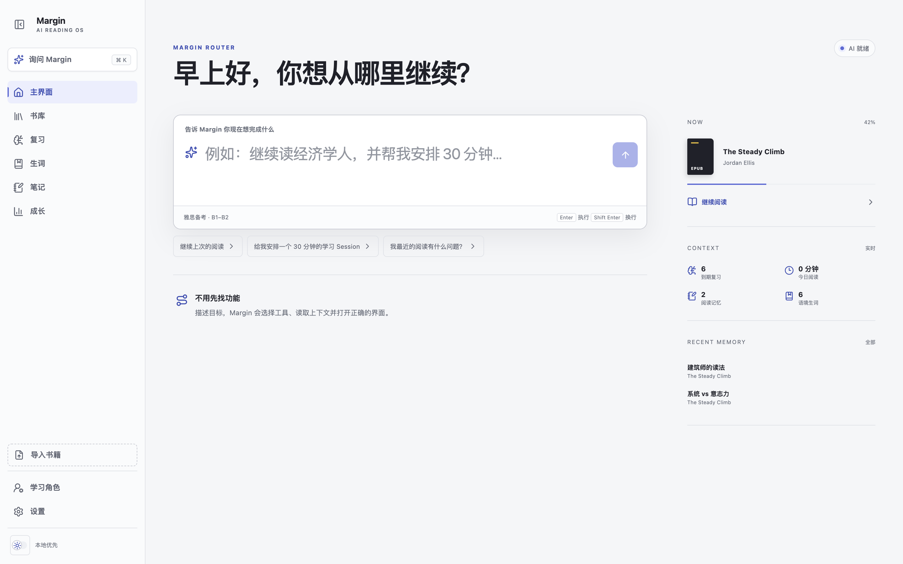
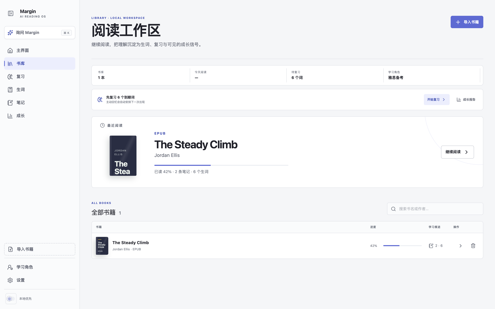
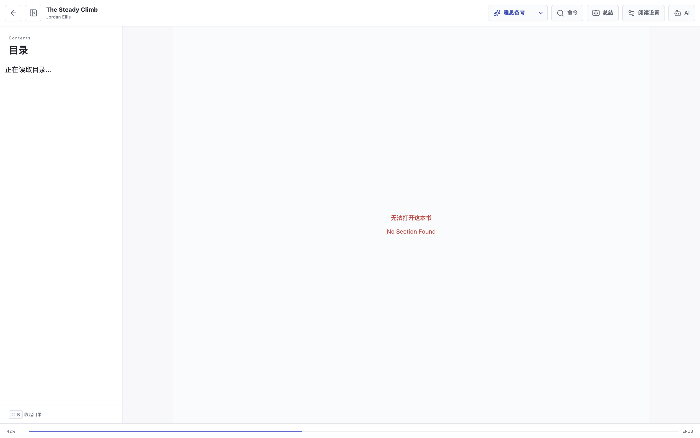
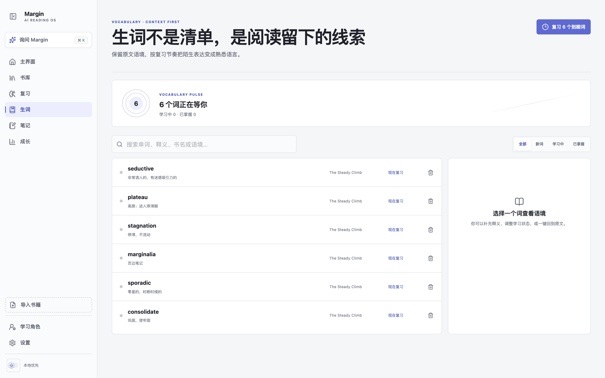
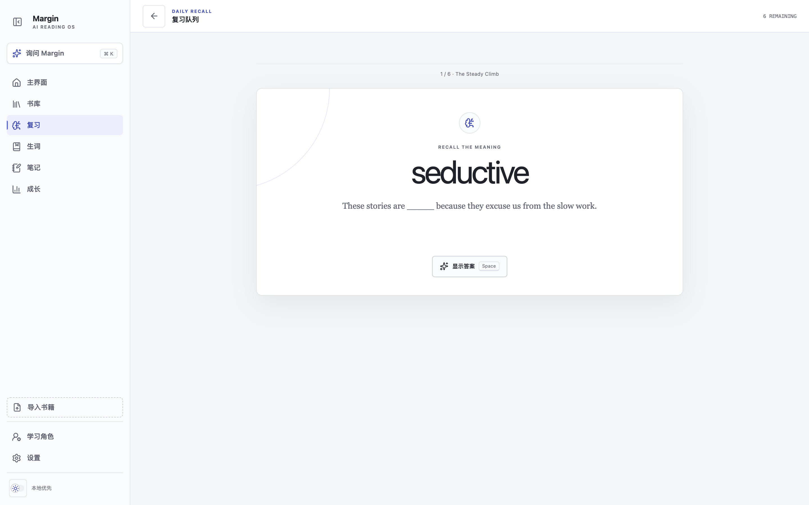
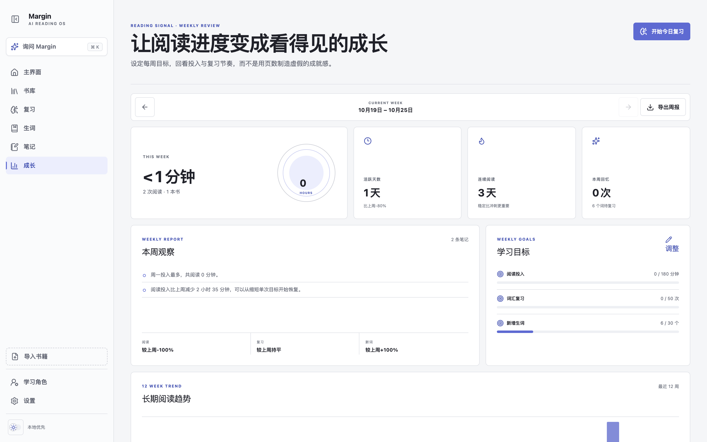

# Margin — Personal AI English Reader

Margin 是一个本地优先的个人英文阅读与学习工作区。它把 EPUB / PDF 阅读、生词积累、间隔复习、全文搜索、阅读成长数据和按需 AI 学习动作放在同一个闭环里。界面方向采用 Readwise Reader 的连续阅读感与 Linear 的紧凑控制方式，并提供完整夜间主题。

## 界面一览

> 以下截图来自隔离的演示数据（演示书籍为自制 EPUB，非真实书库）。

| 主界面（AI Router） | 书库 |
| :---: | :---: |
|  |  |

| 阅读 | 生词 |
| :---: | :---: |
|  |  |

| 间隔复习 | 成长 |
| :---: | :---: |
|  |  |

## 当前版本

截至 2026-10-18，项目已完成 **10 个主要版本**，从初始版本之后完成了 **9 次主要更新**，当前里程碑为 **v0.10.0**。

| 项目 | 当前状态 |
| --- | --- |
| 当前版本 | `v0.10.0` |
| 已完成主要版本 | 10 个 |
| 初始版本后的主要更新 | 9 次 |
| 支持格式 | EPUB、PDF |
| PDF 阅读方式 | 图文重排、PDF 原版；OCR 按书可选本地 Tesseract.js（英文）/ PaddleOCR-VL（中英文） |
| 学习闭环 | 生词、间隔复习、阅读数据、周报、目标、全文搜索、AI 学习动作 |
| 数据位置 | 本地文件 + SQLite |
| AI 服务 | DeepSeek，用户主动请求时调用 |

## v0.10.0 — 可选重排策略与本地 Tesseract OCR

这一版把"怎么重排"变成每本书自己的选择：导入时可选自动、不重排、本地 OCR 或云端 API 重排，随时可在书库中修改。

### 重排策略

- 导入 PDF 时新增"重排策略"下拉（自动 / 不重排 / 本地 OCR / 云端 API），仅对 PDF 显示；默认"自动"维持原有按解析质量分流的行为。
- 选"不重排"的书默认以 PDF 原版打开；阅读器内仍可手动切换图文重排，手动切换时优先使用已配置的云端引擎，未配置则回退本地 OCR。
- 书库中每本 PDF 的行内下拉可随时修改策略；策略变化会自动清除该书的重排缓存与资产，下次重排按新引擎重新生成。
- 重排缓存按引擎校验：整本识别必须来自当前策略要求的引擎，混合文档在已有 OCR 页时同样校验，避免读到错误引擎的旧结果。

### 本地 Tesseract OCR

- 以 tesseract.js 7 与随应用安装的英文语言包（`@tesseract.js-data/eng`）重建本地 OCR 路径，与 PaddleOCR-VL 平行可选，替代 v0.6 被移除的旧实现。
- 扫描页按 1.7–2.4 倍分辨率渲染后识别，保留词坐标与置信度，复用与原生文字完全相同的行合并、表格、多栏排序与段落重建链。
- 整本识别时每页保存 `scan-page-*.webp` 扫描原图，在重排视图中以"扫描页原图"形式展示，便于核对。
- 本地 OCR 无需任何配置、不联网；仅针对英文优化，中文扫描书建议选择云端策略或保持原版。

### 数据与工程

- `books` 表新增 `reflow_policy` 列，启动时对旧数据库做幂等迁移，存量书自动归为"自动"。
- 设置页与 `/api/ocr/status` 新增本地 OCR 状态；阅读器的加载、重试与页签文案按实际引擎显示（本地 OCR / Paddle OCR）。
- tesseract.js 与英文语言包正式登记进 `package.json`，此前是 node_modules 中的孤儿依赖。

真实验证：315 页扫描 PDF 全书本地 OCR 约 113 秒完成并同步建立全文索引；单页英文识别置信度约 95%；迁移、策略端点、三种导入策略落库、无 Token 时的 503 回退、跨引擎缓存失效均逐项验证通过。

## v0.9.0 — PaddleOCR-VL 与响应式阅读器

- 扫描型 PDF 的中英文 OCR 统一接入 PaddleOCR-VL 官方 API；数字型 PDF 仍优先读取原生文字层，减少不必要的 API 调用。
- Paddle 返回的 Markdown、表格和图片资源会转换为本地 `reflow-v8` 图文缓存；图片不会因重排而被静默丢弃。
- 阅读器始终保留“图文重排 / PDF 原版”选择；未配置 Token 或识别失败时会明确提示并允许立即回到原版。
- 新增服务端 OCR 状态接口与设置页状态卡，Token 只从 `.env.local` 读取，不进入浏览器和 SQLite。
- 移除英文专用 Tesseract 路径；阅读器改用动态视口高度，并针对 1180、920、760、430px 与短窗口逐级压缩低频控件，正文、设置和错误信息均可滚动访问。

## v0.8.0 — 可恢复的阅读 Session

这一版让 Agent Harness 从“一次性路由”升级为“拥有任务状态的执行环境”。Margin 生成的阅读计划会保存在本地，刷新页面或离开阅读器后仍能继续。

### Session 状态与恢复

- “安排 30 分钟阅读”等计划会根据到期复习、当前书籍和收尾沉淀自动拆成 2–3 个步骤。
- 当前 Session 保存到本地 SQLite，记录总时长、当前步骤、每一步状态、相关书籍和更新时间。
- 主界面右侧新增 Active Session，支持逐步完成、继续当前动作和主动结束；进度会即时更新。
- 创建新 Session 时自动收起未完成的旧 Session，避免多个计划同时争夺当前任务。
- Session 完成后保留完成反馈，刷新后不再占用当前任务位置。

## v0.7.0 — AI Router 与 Agent Harness

这一版把分散的功能入口收进侧边栏，并新增一个真正面向目标的主界面：用户不需要先判断该去书库、复习、生词还是成长页，只需描述当下要完成的事。

### AI Router 主界面

- 根路径升级为阅读指挥中心，以一个上下文感知输入框承接“继续阅读、安排 Session、搜索、复习、总结、提取生词、生成任务”等高频需求。
- 结果不使用传统聊天气泡，而是返回可继续执行的动作、阅读计划、本地搜索命中或跳转目的地。
- 右侧环境栏持续显示当前书籍、阅读进度、今日阅读、到期复习、笔记和生词，不打断主任务。
- 新增可折叠桌面侧边栏和移动端抽屉；阅读器仍保持全屏、低干扰布局。

### Agent Harness

- 建立上下文快照、意图路由、工具白名单、执行器、结果协议、失败回退和运行追踪组成的最小 Harness。
- 继续阅读、书库、复习、笔记、成长、设置等确定性请求在本地即时路由；开放式问题才调用配置的 DeepSeek 模型。
- 模型只能选择允许的应用工具，书籍 ID 必须来自本地上下文；路由失败时自动回退到本地全文搜索。
- 运行结果记录到本地 `agent_runs`，界面可按需展开“理解意图—读取环境—执行工具”的过程。
- 主界面的“总结 / 生词 / 复习任务”可以把动作带入阅读器，在正文准备完成后自动打开对应 AI 工作流。

## v0.6.0 — OCR、复杂版式与数据可携带

这一版把“能读 PDF”继续推进到“扫描 PDF 也能读、读完还能回看自己的学习节奏”。

### 扫描 PDF OCR

- 使用本地 Tesseract.js 与随应用安装的英文语言包；书籍内容不会因为 OCR 上传到外部服务。
- 先读取 PDF 原生文字层，只有文字缺失或字符数极少的页面才触发 OCR，避免对普通 PDF 做重复识别。
- OCR 页面按 1.7–2.4 倍分辨率渲染，保留行坐标和置信度；原始扫描页作为 `page-scan` 图片继续展示，便于核对。
- OCR 结果会参与多栏排序、图注识别和表格候选识别，并在页面标签显示 OCR 置信度。
- 重新识别会生成 `reflow-v7` 缓存，不覆盖原始 PDF；图文重排失败时仍可切换 PDF 原版。

真实验证：扫描测试页识别置信度 93%，恢复 2 栏、4 列表格（含表头）和图注；407 页的《The Economist [Mar 14th 2026]》约 21 秒完成 v7 分析，保留 140 张图片、识别 12 个 OCR 页面、21 个表格和 37 条图注。

### 阅读成长与周报

- 成长页支持当前周与最近 52 周的周报回看，展示阅读投入、活跃天数、复习和新增生词的环比变化。
- 新增每周阅读分钟、词汇复习次数、新增生词三个可调整目标，并显示完成进度。
- 增加 7 天阅读节奏、12 周长期趋势、词汇掌握率和本周书籍分布。
- 支持将选定周报下载为 Markdown，方便归档或继续加工。

### 数据备份与迁移

- 设置页支持下载完整 ZIP：SQLite 数据、原始 EPUB/PDF、封面和 manifest 一起保存。
- 生词、笔记、阅读会话支持单独导出 CSV。
- 支持从 ZIP 恢复；恢复前会把旧数据库和书籍目录保留在 `data/backups/`，失败时自动回滚文件目录。

### 依赖与运行安全

- 升级 Next.js 到 16.3.3，并应用非破坏性的 npm 安全更新。
- 旧版 `epubjs` 的 XML 解析依赖仍有上游高危审计项，官方修复需要破坏性主版本升级；当前版本继续锁定现有 EPUB 阅读实现，后续单独评估迁移。

## v0.5.0 — Living Reader 与学习闭环

这一版把项目从“可以阅读”提升为“可以长期使用的个人学习系统”。

### PDF 图文重排

- 文本重排升级为图文重排：解析 PDF 绘制操作、图片对象和页面坐标，把图片按原页位置插回阅读顺序。
- 提取图片转为 WebP 并保存在本地版本化缓存中，不需要每次打开重新解析。
- 保留页边界、标题、段落、列表、多栏顺序与图片长宽比。
- 阅读设置可随时在“图文重排”和“PDF 原版”之间切换，每本书记住自己的选择。
- 两种模式共享页码进度、文本选择、高亮、笔记和 AI 上下文。
- 扫描型 PDF 在英文印刷体范围内可由 v0.6 的本地 OCR 辅助阅读；复杂关系要求高时仍可直接使用原版模式。

真实验证使用 407 页的《The Economist [Mar 14th 2026]》：397 页有可重排文字，共提取并定位 140 张图片，图片缓存约 4.8 MB；首次完整解析约 5.7 秒，后续直接读取缓存。

### 学习闭环

- 新增生词本：从阅读选区保存单词和语境，管理释义、掌握状态、来源书籍与回原文位置。
- 新增间隔复习：支持“忘记 / 困难 / 记得 / 轻松”四档反馈，并自动安排下一次复习。
- 新增阅读成长页：统计今日、本周与累计阅读时长、阅读次数、连续阅读天数、7 天节奏和书籍投入分布。
- 新增阅读会话记录：进入阅读器自动开始，页面隐藏时暂停，定期保存可见阅读时间。
- 新增全局本地搜索：同时搜索书名、PDF / EPUB 全文、生词和笔记，并跳回准确页码或 EPUB 位置。
- `⌘ K` / `Ctrl K` 命令面板可直接显示全文命中，不必先离开当前页面。

### AI 学习动作

- 保留选区解释、翻译、句子分析与自由提问。
- 新增当前章节 / 页面总结、生词提取和复习任务生成。
- AI 保持按需调用；打开书或选中文字本身不会自动向外部服务发送内容。
- 生成结果可保存为笔记并继续追问。

### 界面与动效

- 全面重构书库、生词、复习、成长、搜索、笔记与阅读器界面。
- 新增浅色 / 夜间主题并记住用户选择；EPUB iframe 和 PDF 阅读区域同步主题。
- 使用 Learning Pulse 作为复习与成长信号，减少传统仪表盘的卡片堆叠感。
- 增加页面进入、面板、答案揭示、进度与图表动效，统一为 150–340 ms 的空间过渡。
- 完整支持 `prefers-reduced-motion`，减少动画时过渡降到近零。
- 适配 375px 手机、短横屏、桌面与 1440px 宽屏，无页面级横向滚动。

## 历史版本

### v0.4.0 — PDF 双模式与文字重排

- 新增 PDF 文字重排和 PDF.js 原版阅读。
- 支持两种模式共享进度、选择、高亮、笔记与 AI。
- 改进多栏阅读顺序、标题段落识别和数百页 PDF 的进度恢复。

### v0.3.0 — PDF 导入与原版阅读

- 书库导入范围从 EPUB 扩展到 PDF。
- 新增 PDF.js 连续阅读、页码跳转、缩放、适合宽度与文件下载。
- 保存 PDF 页码与阅读百分比。

### v0.2.0 — Reading OS 与连续阅读

- 确定 Readwise Reader × Linear 的产品视觉方向。
- EPUB 默认连续上下滚动，分页作为可选模式。
- 重构书库、阅读器、角色、笔记和设置页面。
- 增加目录、阅读设置、AI 侧栏与全局命令。

### v0.1.0 — 本地优先 MVP

- 建立 Next.js、React、TypeScript 与 SQLite 工程。
- 实现 EPUB 导入、目录、阅读进度、选择、高亮与笔记。
- 提供小说、学术英语、雅思备考等学习角色。
- 接入 DeepSeek 流式回答。

```text
v0.1.0  EPUB + AI 阅读闭环
   ↓
v0.2.0  Reading OS + 连续滚动
   ↓
v0.3.0  PDF 导入 + 原版阅读
   ↓
v0.4.0  PDF 文字重排 + 双模式
   ↓
v0.5.0  PDF 图文重排 + 生词/复习/成长/全文搜索
   ↓
v0.6.0  扫描 PDF OCR + 多栏/表格/图注 + 周报目标 + 数据备份
   ↓
v0.7.0  AI Router 主界面 + 侧边栏 + Agent Harness
   ↓
v0.8.0  持久化阅读 Session + 步骤状态 + 跨页面恢复
   ↓
v0.9.0  PaddleOCR-VL 中英文 OCR + 响应式阅读器
   ↓
v0.10.0  按书选择重排策略 + 本地 Tesseract OCR 回归
```

## 开发进度快照 — 2026-10-18

### 已完成

- PDF 导入新增按书选择的重排策略（自动 / 不重排 / 本地 OCR / 云端 API），策略在书库行内随时可改，修改即清缓存。
- 本地 Tesseract.js OCR 路径完整重建：渲染、识别、坐标换算、扫描页原图与原生重排链复用，全部在本机完成。
- `reflow_policy` 列 + 幂等数据库迁移；重排缓存按引擎校验失效；阅读器与设置页文案按引擎显示。
- tesseract.js 与英文语言包登记进依赖清单；生产构建、类型与 lint 检查全部通过。

### 已验证

- `npm run typecheck`：通过。
- `npm run lint`：通过。
- `npm run build`：通过（Webpack 生产构建）。
- 策略链路：迁移、policy 端点（合法 / 非法值）、三种导入策略落库、无 Token 时 API 策略 503、"不重排"手动重排回退本地、策略切换后缓存拒用与重算，均通过。
- 本地 OCR：单页英文识别置信度约 95%；315 页扫描 PDF 全书本地重排 113 秒完成并建立全文索引；扫描图资产服务与路径穿越防护通过。
- 测试书籍与临时文件已清理，书库恢复原有两本书。

### 当前边界

- 复杂开放问题仍依赖 `.env.local` 中配置的 DeepSeek 模型；未配置时清晰降级到本地搜索 / 本地动作。
- 本地 OCR 为英文质量；长任务仍是单请求一次性完成，进度展示、取消与失败重试属于后续范围。
- 本地开发服务器当前运行中；如已停止，重新运行 `npm run dev` 后访问 `http://127.0.0.1:8190`。

## 本地运行

环境要求：Node.js 20+、npm。

```bash
npm install
cp .env.example .env.local
npm run dev
```

默认打开 [http://127.0.0.1:8190](http://127.0.0.1:8190)。项目默认开发端口和生产启动端口均为 `8190`。

macOS 用户也可以双击 `scripts/open-margin-reader.command` 与 `scripts/close-margin-reader.command` 管理应用，并按需将它们的别名放到桌面；关闭脚本只终止本项目在 8190 端口的进程。

应用数据位于项目的 `data/` 目录；该目录与 `.env.local` 均已加入 `.gitignore`。

## 配置模型 API

编辑 `.env.local`：

```dotenv
DEEPSEEK_API_KEY=你的密钥
DEEPSEEK_BASE_URL=https://api.deepseek.com
DEEPSEEK_MODEL=deepseek-v4-flash

PADDLEOCR_ACCESS_TOKEN=你的 PaddleOCR Token
PADDLEOCR_MODEL=PaddleOCR-VL-1.6
```

API Key / Token 只由服务端路由读取，不会发送到浏览器，也不应提交到 Git。修改环境变量后需要重启开发服务器。没有配置 PaddleOCR Token 时，扫描型 PDF 可以选择本地 OCR 重排（英文、不出本机）或 PDF 原版阅读。

隐私边界：只有在用户明确点击解释、总结、生词、复习任务或发送追问时，对应选区或当前章节 / 页面文字才会发送给配置的 DeepSeek API。选择云端重排策略时整本 PDF 会上传 PaddleOCR-VL 服务；选择本地 OCR 或 PDF 原版则书籍内容不离开本机。书籍文件、全文索引、生词、笔记与阅读数据默认留在本机。

## 页面入口

- `/`：AI Router 主界面、当前阅读环境与目标路由
- `/library`：书库、学习状态与 EPUB / PDF 导入
- `/reader/[bookId]`：EPUB / PDF 阅读器
- `/vocabulary`：语境生词本
- `/review`：到期生词复习
- `/insights`：阅读成长与学习信号
- `/search`：书名、全文、生词与笔记搜索
- `/notes`：个人笔记与保存的 AI 回答
- `/roles`：学习角色管理
- `/settings`：模型、本地数据与访问范围说明

## 数据与缓存

- SQLite 保存书籍元数据、阅读进度、高亮、笔记、角色、生词、复习记录、阅读会话、全文索引与 Agent 运行追踪；每本书的重排策略保存在 `books.reflow_policy`，修改策略会自动清除对应缓存。
- 数据表在应用启动时幂等创建，旧版本本地数据库会自动补齐当前版本所需结构。
- EPUB 原文件、PDF 原文件、封面和 PDF 图文重排资产保存在 `data/books/`。
- PDF 重排缓存带版本号；解析算法更新后会生成新缓存，不覆盖原始 PDF。当前缓存为 `reflow-v8`，包含 OCR、图片、表格与图注统计；本地 OCR 的扫描页原图保存为 `scan-page-*.webp`。

## 当前边界

- 重排策略按书可选：本地 Tesseract.js 处理英文且不出本机，云端 PaddleOCR-VL 处理中文、英文与混排；手写内容、低清扫描和复杂数学符号仍可能需要切换 PDF 原版核对。
- 本地整本 OCR 是单请求一次性任务，数百页的书需要数分钟；进度展示、取消与失败重试尚未提供。
- 表格、信息图、跨栏图片、浮动注释等复杂页面会尽量恢复阅读顺序，视觉关系要求高时以原版为准。
- 全文搜索是本地索引，首次搜索未建立索引的旧书时可能需要短暂等待。
- 项目仍面向个人单机使用，不包含账号、云同步与多设备协作。
- AI 回答质量、延迟和费用由用户配置的模型与 DeepSeek 服务状态决定。

## 质量检查

```bash
npm run typecheck
npm run lint
npm run build
```

v0.6 已完成真实浏览器 QA：1440px 桌面成长页、390px 移动端成长页/设置页/PDF 阅读器、横向溢出检查、WCAG 2 A/AA 自动审计（0 violations）。成长页环形指标的伪元素背景仍会被 axe 标为 incomplete，属于工具无法判定背景的提示，已人工确认文字可读。

v0.10 已完成真实 API 验证：数据库迁移、策略端点、三种导入策略落库、无 Token 时的 503 回退、"不重排"手动重排回退本地、跨引擎缓存失效与重算、扫描图资产服务与路径穿越防护；315 页扫描 PDF 全书本地 OCR 113 秒完成并建立全文索引。

## 下一版本候选

- OCR 长任务进度展示、取消与失败重试，含本地整本识别的 worker 超时保护。
- 本地 OCR 中文语言包评估，或按语言自动选择本地 / 云端引擎。
- 更精确的杂志跨栏图片、脚注、浮动注释和图表关系识别。
- OCR 结果人工校正与低置信度局部重跑。
- 周报提醒、复习历史趋势与词汇掌握预测。
- 在不影响现有 EPUB 阅读的前提下评估 `epubjs` 安全依赖迁移。
